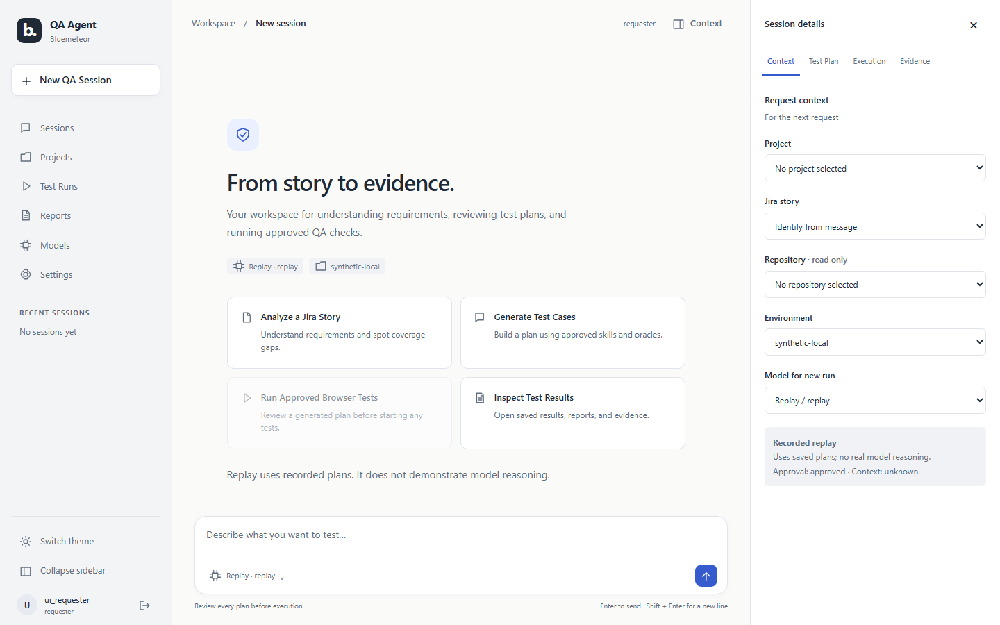
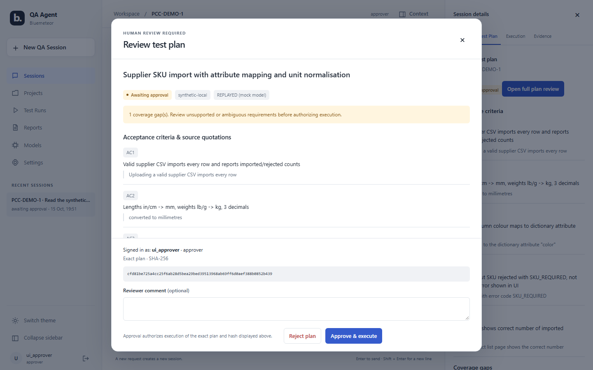
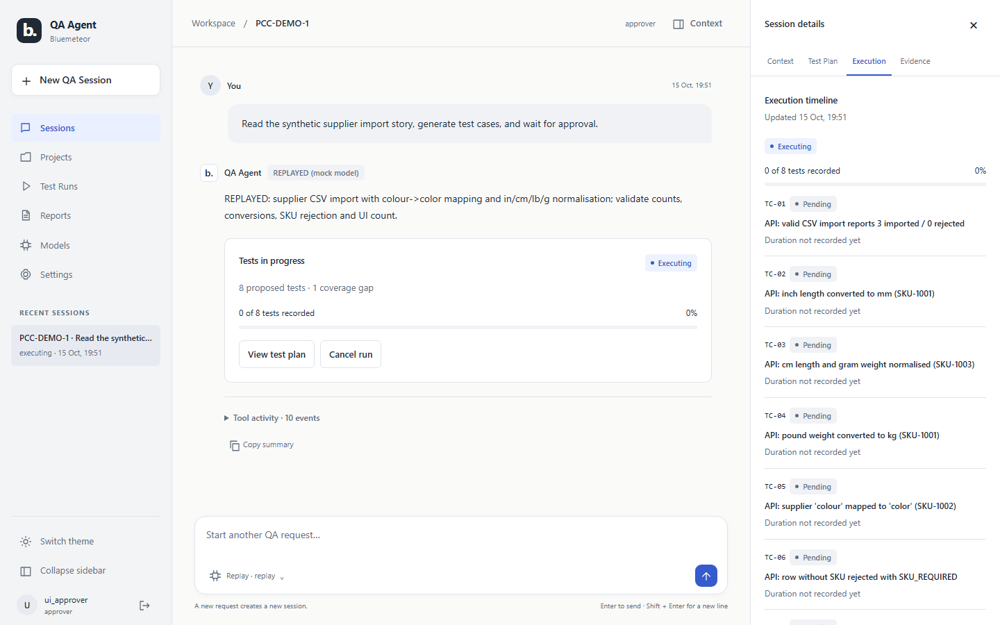
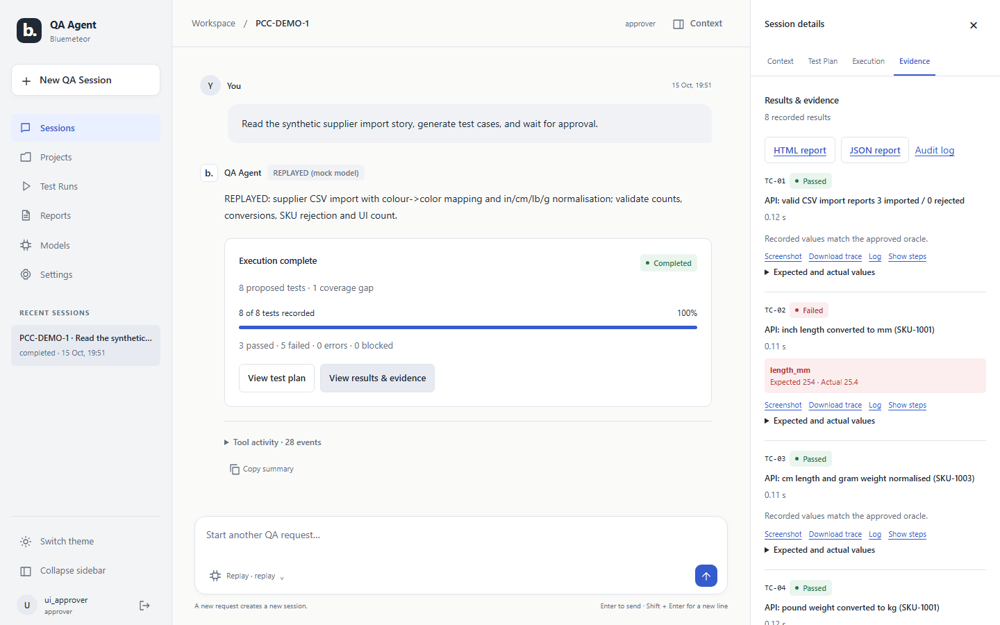
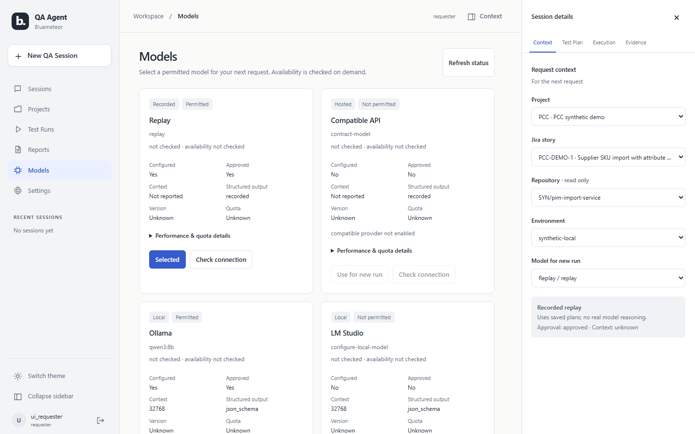
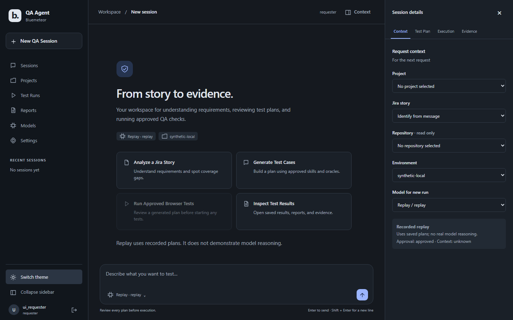
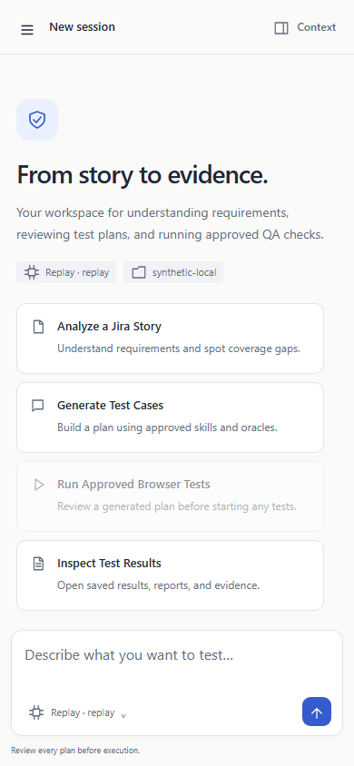
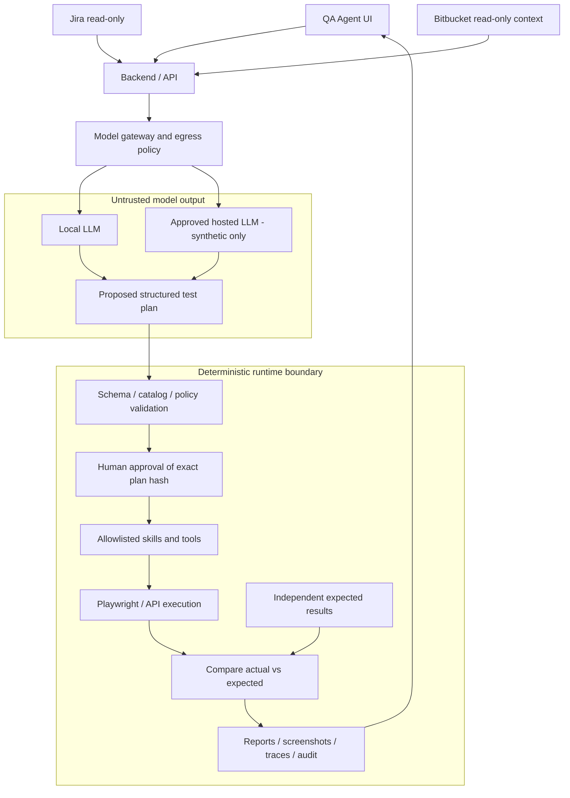

# Bluemeteor QA Agent — Open, Local-First AI Testing Assistant

A standalone QA workspace that turns a story into a proposed test plan, asks a person to review it, then runs approved browser and API checks and collects evidence. It helps QA engineers trace tests to acceptance criteria, see coverage gaps, and compare actual results with independent expected results.

The current runnable domain is **synthetic supplier imports and attribute mapping**. The wider vision is a QA workspace independent of any single model provider. Local models let teams experiment without a paid API account; optional hosted free tiers offer another route when explicitly authorized. Human approval remains essential because a plausible model-generated plan can still be wrong.

**Current maturity:** a local prototype with deterministic execution safeguards. Replay demonstrations and mock provider contracts work; real-model quality and real organization integrations have not been certified. Hosted inference is disabled by default. The project is [MIT licensed](LICENSE).

The [enterprise readiness assessment](docs/enterprise-readiness/ASSESSMENT.md) records the remaining security, integration, model-quality and operational gaps against the merged UI-1 code. The [qualification plan](docs/enterprise-readiness/TEST_PLAN.md) covers token and MCP connections to Jira/Bitbucket, organization sandbox testing and staged adoption; its [scenario inventory](docs/enterprise-readiness/SCENARIOS.csv) distinguishes existing offline coverage from work still requiring implementation or live qualification.

Implementation is ongoing on `codex/enterprise-readiness`. The [current implementation ledger](docs/enterprise-readiness/IMPLEMENTATION_STATUS.md) and [verification notes](docs/enterprise-readiness/IMPLEMENTATION_NOTES.md) distinguish shipped controls from remaining qualification gates. Setup guides cover [OIDC/project access](docs/enterprise-readiness/IDENTITY_SETUP.md), [token/MCP connections](docs/enterprise-readiness/CONNECTION_SETUP.md), [source/model approvals](docs/enterprise-readiness/DATA_APPROVAL_SETUP.md), [audit recovery](docs/enterprise-readiness/AUDIT_OPERATIONS.md) and [operations](docs/enterprise-readiness/OPERATIONS.md).

## Contents

- [Feature overview](#feature-overview)
- [Screenshots and demonstrations](#screenshots-and-demonstrations)
- [Architecture](#architecture)
- [Supported AI providers](#supported-ai-providers)
- [Quick start — Windows](#quick-start--windows)
- [Running with Ollama](#running-with-ollama)
- [Free hosted LLM configuration](#free-hosted-llm-configuration)
- [Typical QA workflows](#typical-qa-workflows)
- [Evaluation and benchmarking](#evaluation-and-benchmarking)
- [Security model](#security-model)
- [Project structure](#project-structure)
- [Developer guide](#developer-guide)
- [Troubleshooting](#troubleshooting)
- [Roadmap](#roadmap)
- [License and contributions](#license-and-contributions)

## Feature overview

**Available** means implemented for the documented synthetic/local workflow. **Experimental** means an adapter or model-dependent path exists but still needs real access or evaluation. **Planned** means the capability is not implemented end to end.

| Capability | Status | Actual scope |
|---|---|---|
| AI-generated test plans | Experimental | Structured understanding, behaviors, tests and gaps; real-model quality evaluation pending. Replay is recorded output. |
| Jira story reading | Available / Experimental | Synthetic fixtures available; Cloud/Data Center read-only adapters tested against mocks, disabled for real sites. |
| Reviewed Jira writes | Experimental / Disabled | Separate Cloud create/comment/transition capability; exact human review and a separate send step. Live mappings, credentials and qualification remain pending. |
| Acceptance-criteria extraction | Experimental | Source-quoted ACs, including explicitly approved custom fields and content-hash citations; reasoning quality remains unqualified. |
| Unsupported story review | Available | Deterministic, non-executable source review and capability gaps when independent expected results are absent; no model/SUT calls. |
| Playwright browser automation | Available | Registered synthetic upload, error and product-count checks; no arbitrary website agent. |
| API testing | Available | Registered supplier import and per-product validation actions. |
| Selected contextual evidence | Experimental / Opt-in | Owner-selected files at full commits, comments and text attachments can inform planning with digest/line citations and handoff revalidation. Other repository context remains recorded only. |
| Test reports | Available | HTML, JSON and JSON checksum per run. |
| Screenshots and traces | Available | Real Chromium evidence with artifact manifests. |
| Human approvals | Available | Immutable execution-envelope hash, expiry and distinct-human review; snapshots bind source, target, policy, fixtures, oracles and implementation. |
| Organization sign-in | Experimental | Pinned OIDC/PKCE, expiring revocable sessions and tenant/project roles; actual IdP qualification pending. |
| Token/MCP connections | Experimental | Human-reviewed resource discovery and scoped adapters; pinned remote MCP reads; hosted schemas/OAuth/live contracts pending. |
| Responsive QA workspace | Available | Conversation, dedicated plan review, execution/evidence tabs, light/dark themes and mobile drawers. |
| Model selection | Available | Administrator-approved provider/model for each new run; read-only settings and connection probes. |
| Local inference | Experimental | Native Ollama and compatible LM Studio/llama.cpp/vLLM; protocol tests passed, installed-model evaluation pending. |
| Free hosted inference | Experimental | Groq, Gemini and explicit OpenRouter free models; disabled pending account and egress approval. |
| Credential management | Available / Planned | Server-side environment references, hashed local credentials and revocable sessions; managed vault/evidence encryption/rotation remain open. |
| Operations | Experimental | Protected metrics, minimized logs, process readiness and recoverable audit projections/checkpoints; live monitoring/recovery qualification pending. |
| Jira defect reporting | Planned | Evidence reports available locally; no Jira create/comment/transition operations. |
| Regression execution | Available / Planned | Rerun individual approved synthetic plans today; suite scheduling and orchestration planned. |
| Release sanity testing | Planned | No automated release gate or release-wide orchestration. |

## Screenshots and demonstrations

The redesigned workspace keeps the conversation in the center, request context and execution in a collapsible panel, and navigation in a sidebar or compact rail. Light/dark themes and mobile drawers are included. See the [UI-1 audit, workflow map and validation](docs/ui-1/WORKSPACE_REDESIGN.md) and [before/after gallery](docs/ui-1/SCREENSHOTS.md).

These are real browser captures of the running app with **recorded replay plans** and temporary local test identities. They demonstrate UI behavior and actual synthetic browser/API execution, not LLM reasoning or production certification.



Open **Context** to choose a project, Jira story, repository, environment and permitted model. A generated plan opens in a dedicated review dialog; a distinct authenticated reviewer authorizes its exact hash in local auth mode.



<details>
<summary>Execution, evidence, model settings, dark theme and mobile</summary>











The synthetic SUT deliberately contains planted defects. Provider availability is checked on demand; catalog configuration is not proof of live inference. Earlier [B1](docs/screenshots/01_plan_awaiting_approval.png) and [B2-FREE](docs/b2-free/screenshots/01_plan_awaiting_approval.png) captures remain historical evidence.

</details>

## Architecture



Models propose plans; the runtime controls execution and expected results. Bitbucket context currently stops at run metadata. See [architecture and security](docs/ARCHITECTURE_SECURITY.md) for boundaries, auth and environment authorization.

## Supported AI providers

**Groq is not Grok. The xAI Grok runtime dependency has been removed.** Historical evidence may retain old labels; it is not current setup guidance. No provider/model fallback happens automatically.

| Provider / configuration ID | Location | Implementation / default | Key | Cost nature | Setup and limits |
|---|---|---|---|---|---|
| Ollama / `ollama` | Local | Native adapter; enabled on loopback | No | Local hardware/electricity, model license applies | [Local guide](docs/SETUP_LOCAL.md#ollama-on-windows); manual install/pull, completion and context checks. |
| LM Studio / `lmstudio` | Local | Compatible adapter; disabled | No on loopback | Local hardware, model/tool terms apply | [Local servers](docs/SETUP_LOCAL.md#other-local-servers); exact loaded ID, server context and structured-output support required. |
| llama.cpp / `llamacpp` | Local | Compatible adapter; disabled | No on loopback | Local hardware, model license applies | [Local servers](docs/SETUP_LOCAL.md#other-local-servers); chat template and schema grammar support required. |
| vLLM / `vllm` | Local | Compatible adapter; disabled | No on loopback | Local hardware, model license applies | [Local servers](docs/SETUP_LOCAL.md#other-local-servers); structured-output backend required; server installation is separate. |
| Groq / `groq` | Hosted | Strict schema adapter; disabled | `GROQ_API_KEY` | Account-dependent free tier | [Groq setup](docs/SETUP_HOSTED.md#groq); verify exact model entitlement and account quotas. |
| Google Gemini / `gemini` | Hosted | Native `generateContent`; disabled | `GEMINI_API_KEY` | Model/account-dependent free tier | [Gemini setup](docs/SETUP_HOSTED.md#google-gemini); account-verified Flash model, no assumed model ID. |
| OpenRouter / `openrouter` | Hosted | Compatible adapter; disabled | `OPENROUTER_API_KEY` | Explicit free model routes with limits | [OpenRouter setup](docs/SETUP_HOSTED.md#openrouter); exact `:free` ID, structured support, no fallback. |
| NVIDIA NIM / `nvidia` | Hosted placeholder | **Deferred; no enabled adapter** | None usable; `NVIDIA_API_KEY` reserved | Unverified | [Deferred status](docs/SETUP_HOSTED.md#nvidia-nim-deferred); access, permitted use and free availability unconfirmed. |
| Replay / `replay`; compatible stub | Offline / loopback | Recordings / HTTP contract simulator; explicit selection | None / fake stub key | No inference charge | [Quick start](#quick-start--windows) / [mocks](docs/DEVELOPMENT.md#local-mock-services); never model-quality evidence. |

All real adapters have offline contract coverage; that does not prove current service availability or reasoning quality. The generic `compatible` priced adapter is retained, disabled, for contract tests and future explicitly approved priced use. Free hosted services have quotas and changing availability, retention/training policies and commercial-use terms. Verify the actual account and terms; “free” is not permanent and local counters do not guarantee zero billing. [Account checks and official references](docs/SETUP_HOSTED.md).

## Quick start — Windows

Prerequisites: Git, Python **3.12+** and PowerShell. CI uses Python 3.12; the documentation walkthrough was also checked on Windows/Python 3.13. This no-account demonstration explicitly selects replay. It runs real browser/API tests against a local synthetic application.

```powershell
git clone https://github.com/AnkitParekh007/grok-bots-agency.git
cd grok-bots-agency
python -m venv .venv
.\.venv\Scripts\python.exe -m pip install --require-hashes --only-binary=:all: -r requirements.lock
.\.venv\Scripts\python.exe -m playwright install chromium
```

Terminal A, from the repository root, starts the synthetic application with planted defects:

```powershell
$env:SUT_DEFECTS = 'all'
.\.venv\Scripts\python.exe -m uvicorn sut.app:app --host 127.0.0.1 --port 8601
```

Terminal B, also from the repository root:

```powershell
$env:PYTHONUTF8 = '1'
$env:QA_MODEL_PROVIDER = 'replay'
$env:QA_AUTH_MODE = 'demo'
.\.venv\Scripts\python.exe -m qa_agent.server
```

Open [the workspace](http://127.0.0.1:8600) and optionally [the synthetic application](http://127.0.0.1:8601). In a third PowerShell terminal, this opens the workspace in your default browser:

```powershell
Start-Process 'http://127.0.0.1:8600'
```

Keep `synthetic-local` and `replay / replay` selected. Send: **“Read the synthetic supplier import story, generate test cases, execute the approved tests, and give me the results.”** Review the ACs, gaps and tests, then select **Approve & execute**. Open the HTML report and evidence links after completion. With `SUT_DEFECTS=all`, PCC-DEMO-1 should report **3 passed and 5 failed**: those failures detect planted defects. Stop Terminal A, set `$env:SUT_DEFECTS = ''`, restart it and create/approve a new run to compare the defect-free case (8 passed). Stop servers with Ctrl+C.

Demo auth is unauthenticated and intended for one trusted workstation. Use [local role-based auth](docs/ARCHITECTURE_SECURITY.md#local-authentication) before testing requester/approver separation. No `.env` file is loaded. Virtual-environment activation is optional because these commands use its interpreter directly.

## Running with Ollama

Follow the [complete Windows local-model tutorial](docs/SETUP_LOCAL.md): install Ollama, size and manually pull a model, verify the local service, configure the exact installed ID and context, select it in Model Settings, generate a real plan, review/approve it, execute against synthetic data, and open the report. It includes GPU/VRAM guidance and model, memory, context and JSON troubleshooting. The application never downloads a model. Local inference has no hosted API requirement, but quality and speed depend on your model and hardware.

[B3 diagnostics and supervised local evaluation](docs/b3/LOCAL_MODEL_EVALUATION.md) records the CPU/Intel trial and authenticated handoff. Native Ollama 0.40.4 / Qwen3 1.7B Q4_K_M completed real inference in 415.76 s at 4.899 generated tokens/s, but **planning failed** an oracle/action policy check. No tests executed; the full benchmark remains **NOT_EVALUABLE**. Offline tests do not upgrade model quality.

## Free hosted LLM configuration

[The hosted setup guide](docs/SETUP_HOSTED.md) covers each implemented service, process-environment credentials, exact model approval, free-account verification, quotas and the independent HTTPS host allowlist. Hosted services start disabled. The UI cannot grant authorization, install keys or change endpoints. Only synthetic data may enter hosted inference in B2-FREE; a real Jira story is not automatically synthetic. NVIDIA NIM remains deferred.

## Typical QA workflows

| Workflow | Steps and current boundary |
|---|---|
| A — Story to test plan | Choose project `PCC` and a synthetic story, or name `PCC-DEMO-1` in the prompt. Generate quoted ACs, testable behaviors, tests and gaps. Review coverage, then approve the exact plan. Replay displays recorded extraction; a real approved model generates it. |
| B — Browser testing | Start the SUT on port 8601. Approve registered upload/error/count actions; Playwright runs against that environment and saves screenshots/traces. General natural-language website automation is not implemented. |
| C — API testing | Approve supplier CSV import and product checks. Runtime actions call the synthetic API and compare normalized units, attributes and validation errors with oracle manifests. |
| D — Defect identification | Inspect failed comparisons and their actual/expected values, screenshot, trace and log evidence. Export the HTML/JSON QA report; Jira defect creation is planned. |
| E — Regression preparation | Record story IDs, fixture/oracle versions, approved model ID, environment and defect mode. Start and review a fresh run for each story/change, then compare reports. Scheduling, suites and release-wide orchestration are planned. |

## Evaluation and benchmarking

B2 evaluates synthetic PCC stories with planted defects **on and off**, gold expected coverage/results, schema validation and injection attempts. It reports AC precision/recall, coverage/gap metrics, seeded-defect detection, false alarms, repairs, repeatability, latency and token usage. Account quotas constrain real calls; unknown observations stay unknown. Thresholds are proposed, pending QA-lead agreement.

The offline self-test starts its own local services; leave ports available. From the repository root:

```powershell
$env:PYTHONUTF8 = '1'
$env:QA_MODEL_PROVIDER = 'replay'
.\.venv\Scripts\python.exe scripts/eval_b2.py --provider stub --self-test-simulated-review --out reports/eval/readme-stub
.\.venv\Scripts\python.exe scripts/compare_models.py reports/eval/readme-stub/eval_report.json --out reports/eval/readme-comparison
```

**Replay/stub results test the harness, not model intelligence.** The simulated-review flag is for offline self-tests only. Real evaluations need authenticated first-plan review and scoped grants; follow [evaluation procedure](docs/b2/ENABLE_LIVE_EVAL.md). PCC-DEMO-7 has no replay answer and uses externally sealed, hash-verified gold. Blinding is partial: public stories/oracles and shared authorship limit independence. Read [contamination limits](docs/b2/CONTAMINATION_AND_INDEPENDENCE.md) and use an [independent reviewer](docs/b2/INDEPENDENT_REVIEW_TEMPLATE.md) before relying on quality claims.

## Security model

Execution requires validation and approval bound to the full immutable execution envelope; plans expire, and uncertain mutations are not silently replayed. Local/OIDC identities support tenant/project-scoped roles; demo mode uses unauthenticated labels. Source adapters remain read-only; a separate disabled [Jira Cloud write capability](docs/enterprise-readiness/JIRA_WRITES.md) requires exact human review and a separate send action. Browser/API traffic uses a validated application proxy, with independent worker-network isolation still required. Production is prohibited; Test/Playground remain unverified. Organization model input needs separate source-classification and exact model-data approvals. Credentials use server-side references. Audit intents and outcomes use a hash-chained ledger with recoverable file delivery and optional operator-signed checkpoints.

This remains a prototype. Real IdP/source/model qualification, managed secrets/evidence encryption, worker deployment/soak qualification, independent network/audit protection, recovery and governance gates remain open. Defaults authorize synthetic data only; broader data decisions must be explicit. See [architecture and limitations](docs/ARCHITECTURE_SECURITY.md) and the [implementation ledger](docs/enterprise-readiness/IMPLEMENTATION_STATUS.md).

## Project structure

```text
config/                 Agent/provider, tool policy, environment and evaluation settings
qa_agent/
  server.py             FastAPI endpoints and authentication boundary
  static/               Workspace shell, CSS tokens and native JavaScript modules
  runtime.py            Plan → validate → approve → execute lifecycle
  planning.py           Prompt, schema and catalog validation
  providers/            Replay, compatible/native models, quotas and registry
  integrations/         Read-only Jira/Bitbucket adapters and bounded HTTP
  skills/               Registered import and attribute validation actions
  executor.py           Playwright/API execution through the tool gateway
  store.py              SQLite runs/approvals/audit and file artifacts
fixtures/               Synthetic Jira stories, CSVs, oracles, replay, repos, eval gold
sut/                    Synthetic application with switchable planted defects
scripts/                Offline demo, evaluation and report comparison
tests/                  Unit, contract, policy and Chromium integration tests
docs/                   Setup, architecture, roadmap and milestone evidence
.github/workflows/      Existing offline CI workflow
data/                   Generated state/evidence (ignored by Git)
reports/                Generated evaluation/test reports (ignored by Git)
```

## Developer guide

[Development and contribution guide](docs/DEVELOPMENT.md) documents existing Python/JSON conventions, local mock services, adding a provider/skill/integration/story, test markers and CI-equivalent commands. There is no frontend build step. The [CI workflow](.github/workflows/qa-agent-ci.yml) uses replay, loopback services and real headless Chromium without hosted inference credentials.

```powershell
$env:PYTHONUTF8 = '1'
$env:QA_MODEL_PROVIDER = 'replay'
.\.venv\Scripts\python.exe -m pytest -q -m 'not integration' --junitxml=reports/unit.xml
.\.venv\Scripts\python.exe -m pytest -q -m integration --junitxml=reports/integration.xml
```

## Troubleshooting

| Problem | Check / resolution |
|---|---|
| Ollama unreachable | Check the Windows Ollama app, port 11434 and `/api/tags`; start `ollama serve` only if no service is already listening. [Local guide](docs/SETUP_LOCAL.md#troubleshooting-local-inference). |
| Model not found | Compare the exact configured ID with `ollama list` or the compatible server catalog; manually install/load it. Discovery never pulls or approves models. |
| Invalid structured output | Verify completion/chat and schema support, chat template and output allowance. Inspect validation/repair events; never bypass the schema or policy. |
| Hosted HTTP 429 | Respect Retry-After/reset and account limits; reduce concurrency/rate. No automatic provider or paid fallback. |
| Missing API credentials | Set the configured environment variable in the same process shell before startup; no dotenv loader. [Hosted guide](docs/SETUP_HOSTED.md#process-environment-credentials). |
| Host not approved | Administrator must authorize the exact HTTPS model host in `config/policy.json`; provider approval alone is insufficient. |
| Environment unverified | Use `synthetic-local`; real environments need the full safety record, accounts and cleanup verification. [Environment rules](docs/ARCHITECTURE_SECURITY.md#environment-authorization). |
| Test execution blocked | Review plan/hash/expiry, role/ownership, environment and action policy. Another execution may hold the single-run lock. Start a fresh plan after expiry. |
| Playwright browser missing | Run `.\.venv\Scripts\python.exe -m playwright install chromium` with the same interpreter/user as the agent. Linux CI also installs browser OS dependencies. |
| Budget/quota exceeded | Inspect configured/observed RPM/RPD/TPM/TPD, conservative reservations and reset times; paid adapter dollar caps are separate. Wait or correct verified limits; do not reset the ledger to bypass them. |

## Roadmap

| Milestone | Current status |
|---|---|
| A — Synthetic execution foundation | Delivered for the synthetic domain |
| B1 — Secure planning/runtime foundation | Delivered for the local prototype |
| B2 — Model evaluation preparation | Framework delivered; real evaluation and independent review pending |
| C0 — Read-only integration foundation | Adapters delivered; real access disabled |
| B2-FREE — Multi-model/local inference | Provider implementation delivered; real quality evaluation pending |
| C1 — Approved real Jira/Bitbucket access | Approval-gated, not completed |
| C2 — Repository-grounded QA | Selected-source contracts implemented; live/model qualification pending |
| C3 — Environment testing | Planned; nonlocal environments unverified |
| C4 — Human-approved Jira write-back | Implemented / Disabled; live qualification pending |
| C5 — Regression and release sanity automation | Planned |

See [the detailed roadmap](docs/ROADMAP.md) for delivered scope and remaining boundaries.

## License and contributions

The project is available under the [MIT License](LICENSE), approved by the repository owner on 2026-10-16. Dependencies, model weights and external services retain their own licenses and terms.

Propose focused branches and pull requests, describe behavior and validation, and let the existing push/PR CI run. Keep real credentials, customer material, generated state and sealed gold out of commits. See [contribution details](docs/DEVELOPMENT.md#contributions). Historical milestone documents retain their original evidence and superseded labels. [Documentation validation and before/after summary](docs/DOCUMENTATION_VALIDATION.md).
