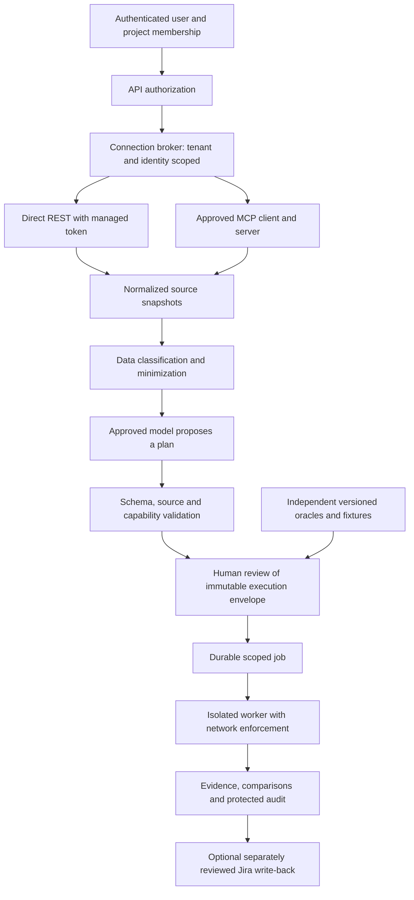

# Product qualification plan: models, organization, Jira and Bitbucket

Baseline/date and the readiness decision are in [ASSESSMENT.md](ASSESSMENT.md). The user's connection requirement is **Jira and Bitbucket through MCP or tokens**. This plan covers both paths and records which capabilities must be built before their tests can pass. It does not assume credentials, organization approval, a model entitlement, a particular Jira edition, or a particular SUT.

## Deliverables and interpretation

- [SCENARIOS.csv](SCENARIOS.csv) contains **178 scenario templates across 18 areas**: IDs, priorities, prerequisites, actions, expected behavior, evidence, current coverage and finding links. Expand these templates across the supported configurations below before execution.
- [EVIDENCE.json](EVIDENCE.json) and [PROBE_RESULTS.json](PROBE_RESULTS.json) record completed assessment work.
- `EXISTING_OFFLINE` in the scenario inventory means there is relevant existing coverage, not that all enterprise variants of that row passed. `OBSERVED_GAP` means the narrow listed behavior was demonstrated. `PLANNED`/`IMPLEMENTATION_REQUIRED`/`LIVE_REQUIRED` remain unexecuted. Use a separate execution ledger for future runs; never mark planned scenarios as passed based on this document.
- No finite inventory establishes every possible scenario. This inventory defines the risk categories, variants, expansion rules, qualification gates and change triggers needed to make coverage explicit and maintainable.

## Target architecture



The broker, MCP path, normalized grounding package, complete immutable envelope and enterprise worker/operating controls in this diagram are target work. Current components and gaps are identified in the assessment. The LLM must not receive unrestricted connector tools or authority to grant approvals. Connector transport selection must not change downstream authorization, provenance, validation or execution policy.

## Connection design and tests

| Route | Current position | Qualification design |
|---|---|---|
| Jira Cloud direct token | REST v3 read adapter exists | Select actual token type, identity, approved scopes, cloudId and base path. Test site-host and API-gateway routing only for token types that support them. Enforce project and issue security at source and caller levels. |
| Jira Data Center direct token | REST v2 read adapter exists | Pin supported DC version and context root; PAT/approved auth, private CA/network policy, paging and custom-field contracts. Do not assume Cloud endpoints or scopes. |
| Bitbucket Cloud direct token | REST 2.0 read adapter exists | Qualify approved repository/project/workspace access token or current API-token authentication. Pin workspace/repositories and least read scopes. Test expiry, revocation and actual account restrictions. |
| Bitbucket Data Center direct token | REST 1.0 read adapter exists | Pin server version/context root; HTTP access token and repo scopes; test default refs/file content and explicitly unsupported search. |
| Atlassian hosted MCP | Not implemented in product | Validate current supported Jira/Bitbucket Cloud tools, resource discovery, org-linked Bitbucket workspace, available auth, scopes and tenant restrictions. Map read operations to existing provider contracts. |
| Organization/private MCP for DC | Not implemented; no server selected | Qualify a separately approved DC-capable server, deployment/auth/transport/schema/version, availability and license. Treat as unsupported until certified; hosted Cloud MCP support is not evidence of DC support. |

Atlassian's [current tool catalog](https://support.atlassian.com/atlassian-ai-gateway/docs/supported-tools/) includes deferred discovery and read/write/destructive dispatchers. An outer `executeRead` name is not enough: validate its specific inner operation, arguments, destination/cloudId, project/repo and response schema. New/discovered tools cannot automatically become permitted. Pin a tested operation/schema set and surface tool-list changes for administrator review.

For remote MCP OAuth, validate server identity, redirect URI/state/PKCE, issuer/audience/resource binding, minimum scopes, token expiry/refresh/revocation and session isolation according to the selected server/protocol. If that server supports API tokens, use its documented auth contract through the secret broker; do not forward arbitrary caller tokens to other audiences. Test token REST and MCP credentials independently. Follow [MCP security guidance](https://modelcontextprotocol.io/docs/2025-11-25/tutorials/security/security_best_practices).

Use app-owned backend connections, not a browser-stored key, shared chat-session connector, or an assumption that Codex-installed MCPs are available to the deployed product. Choose per-user delegation or a project-scoped service account explicitly. With service identities, the app must enforce each caller's approved access independently; source permissions alone are insufficient.

For initial read-only operation, allow only project-scoped issue search/read/approved comments or attachments and allowlisted repository discovery/read/context operations. Prohibit issue creation, comment mutation, transition, branch/commit/PR changes, pipeline runs and deletion regardless of what the token or MCP server exposes. Later write-back is a separate gate.

## Test environments and data

| Tier | Purpose | Data and operations |
|---|---|---|
| T0 offline | Unit/schema/policy/transport faults | Fixtures and MockTransport; no outside network |
| T1 synthetic E2E | Complete app, auth and real Chromium/API execution | Owned loopback services, separate temporary identities, seeded defects on/off; replay/stub and later explicitly approved local inference |
| T2 organization connector sandbox | Actual Jira/Bitbucket token or MCP contracts | Dedicated approved projects/repos, synthetic issues/files and read-only service identities; reads only; no LLM egress yet |
| T3 organization planning shadow | Read and evaluate real-domain requirements | Approved/sanitized source bundle, approved model/data class; no execution; independent QA scoring |
| T4 supervised nonproduction SUT | End-to-end actual application qualification | Dedicated synthetic accounts/data, approved domain actions/oracles, verified cleanup and a distinct authenticated reviewer |
| T5 shared-service qualification | Load, isolation, recovery and operations | Production-like isolated staging; synthetic datasets; no production SUT mutations |

Do not use the organization's live production system as a test fixture. Do not relabel real content synthetic to bypass the data gate. Local inference also needs authorization for that data class. Until ER-05/06/07 are implemented, a connected organization story may be readable but must remain blocked for planning/execution as applicable.

Build a source dataset with at least these independently authored variants:

1. Straightforward numbered ACs with reviewed positive/negative/edge expectations.
2. ACs only in a configured custom field; description intentionally lacks them.
3. Rich ADF/wikitext tables, bullets, nested lists, code, links, Unicode and non-English headings.
4. Missing/ambiguous/contradictory ACs; requirement that is genuinely unsupported by the catalog.
5. AC changes after planning, moved issue, renamed project, stale ref and changed repository default branch.
6. Restricted issue/comment, denied project/repo, revoked identity, cross-tenant resources and misleading identifiers.
7. Bounded comments/attachments/files, empty data, missing fields, huge/compressed content and pagination beyond caps.
8. Benign prompt-injection markers in every newly consumed source and malicious tool/schema descriptions in a synthetic MCP server.
9. Domain regressions with independently planted defects and defect-free controls; expected outcomes sealed before model execution.
10. Long-context and conflicting source versions, redacted sensitive markers and permitted versus forbidden data-class routing.

Use two allowed sandbox projects and one denied project, two allowed repos with distinct permissions and a denied repo, and two separate organization/tenant identities when testing a shared deployment. Create source fixtures through an organization's approved provisioning process; this plan itself does not authorize sending messages or writing to external systems.

## Model qualification matrix

| Lane | Protocol/quality work | Current evidence |
|---|---|---|
| Replay | Workflow/safety/harness only; reject unsupported recording | Offline tests; never a reasoning score |
| Local compatible stub | Protocol faults, usage, retries, correlation, quotas and evaluation harness | Offline tests; never a reasoning score |
| Native Ollama | Exact installed model/digest/template/quantization; structured JSON, context, latency and semantic quality | One Qwen3 1.7B trial failed semantic validation; full benchmark NOT_EVALUABLE |
| LM Studio | Exact loaded model/version and server context; compatible contract and live qualification | Offline contract coverage; live quality unqualified |
| llama.cpp | Exact model/quantization/chat template/schema grammar/server build | Offline contract coverage; live quality unqualified |
| vLLM | Exact model/dtype/server/structured-output backend; serving/load behavior | Offline contract coverage; live quality unqualified |
| Groq | Exact approved account-entitled model, schema support, observed quota/usage and policy | Disabled; offline contracts only |
| Gemini | Exact account-approved configured model, native response/schema/safety/usage behavior | Disabled; offline contracts only |
| OpenRouter | Explicit approved `:free` ID, routing/data-policy identity, no auto fallback | Disabled; offline contracts only |
| Generic compatible paid | Only if explicitly selected/approved; verified pricing plus monetary/token caps | Disabled; offline contracts only |
| NVIDIA NIM | Disabled/deferred capability-denial test | No enabled adapter; not a selectable live qualification candidate |

Do not pick a live model from a marketing claim or compare unmeasured speed/quality. Start with the already approved installed model only if the operator chooses another supervised trial; its previous failure remains part of the evidence. A larger model, a different runtime, hardware, hosted account or paid tier requires its own setup/authorization. No downloads or paid calls are implicit in this test plan.

For every approved real lane, test cold/warm load, CPU versus supported acceleration, memory pressure/OOM, unload/reload, missing runtime/model, unexpected version/model ID, context and output limits, timeout, structured-output refusal, invalid/truncated JSON, valid-but-wrong action/oracle, unknown usage, secret redaction, quota exhaustion and deterministic no-fallback behavior. Record actual runtime/hardware; do not assume Intel inference is accelerated or all engines can run on this machine. Local protocol contracts remain useful even where a server requires a different host.

## Coverage expansion rules

The CSV contains scenario templates; it is not one test per provider. Generate an execution manifest with these dimensions before each qualification:

- Every enabled model ID/version/runtime/settings tuple. Run transport/safety contracts for all implemented lanes even if disabled; disabled lanes must deny selection without network.
- Every promised Jira/Bitbucket topology and auth route, including mixed routes (for example Jira MCP + Bitbucket token). Cloud and DC are separate contracts.
- Roles: anonymous, viewer, owning requester, other requester, distinct scoped approver, same-person approver/requester, admin/service identities and a revoked identity.
- Source/data classes: synthetic, approved internal, restricted and unclassified; include explicit provider/data denial cases.
- Story/skill domains, short/near-limit/over-limit payloads, defect on/off, supported environment versions and clean/expired/partial/cancelled states.
- Supported browsers/platforms, viewport/zoom/theme/accessibility modes and concurrency tiers.

Run the full security/approval/egress and project-isolation cases across **every enabled route and model boundary**. For quality qualification, use at least **30 independently reviewed stories per claimed domain** (10 development, 20 held out), 3 repetitions and defect on/off: **180 attempts per model/domain**, including failures in denominators. Report held-out and development scores separately. This proposed dataset exceeds the current five-story repeated harness; domain actions/oracles and sealed gold must be built first. Repetitions do not create independent stories; report story-clustered confidence intervals, not a false sample size of 180 independent requirements.

Use full model × connection-route coverage for critical end-to-end happy/deny paths. Use documented pairwise combinations for lower-risk browser/theme/payload permutations and add explicit three-way cases for model × data classification × connector identity. Produce the generated manifest and report unrun combinations. If a server/route/browser is unsupported, fail configuration clearly or record an explicit scope exclusion approved by the product owner; do not silently skip a promised capability.

## Execution phases and release gates

### G0 — Preserve the existing synthetic baseline

Freeze code/config/catalog/prompt/schema/evaluation hashes and the installed test environment. Run the commands below. Verify expected results as well as process exits: planted-defect failures are expected, execution errors are not passes. Keep replay/stub outputs distinct from real inference. Add focused regression tests for ER-08/09 when fixing them; rerunning unchanged existing tests cannot close newly demonstrated gaps.

### G1 — Certify organization connections without inference

Record organization/data-owner approval, target edition/version, allowed projects/repos/operations, token/MCP route, identities and scopes. Establish actual sandbox reads, normalize both routes, and run CON/JIR/BIT/MCP/IAM denial cases. Confirm zero unexpected writes from independent upstream audit, credential rotation/revocation and source permission differences. Enabling a selected connection is an administrator deployment step after these prerequisites, not a UI model selection.

**Exit:** all applicable read contracts and access denials pass; no credential leakage; truncation/unsupported operations explicit; source/connection versions and upstream audit receipts retained. If MCP is selected, MCP cases are mandatory. If direct tokens are selected, MCP remains visibly unimplemented/deferred and cannot be advertised as supported.

### G2 — Qualify real-domain planning in shadow mode

Implement the missing classification/grounding/unsupported-story path. Ingest only approved source snapshots; do not execute. Freeze independent gold and score every attempted story/model. Have QA reviewers classify plan defects, including source omissions, invented behavior, action/oracle mismatch and misleading coverage. Block a plan when capabilities are absent; do not force a plausible executable plan.

**Exit:** model/domain quality and data-routing gates below pass; independent reviewer accepts semantic correctness; unavailable sources are visible as gaps. Failure here stops execution qualification even if JSON is valid.

### G3 — Qualify supervised nonproduction execution

Implement full reviewed input binding and browser/API network containment first. Onboard environment-specific actions, authentication, synthetic fixtures, oracles and cleanup. Verify SUT version/network/identity. A separate authenticated approver reviews every exact execution envelope; automation may use only a separately issued scoped grant whose allowed uses, source/model/target scope and expiry are verified. Existing self-test simulated review is exclusively offline harness behavior.

Execute defect-on/off scenarios, then cancellation, expired session, unavailable dependencies, redirects, stale inputs, partial execution and cleanup failures. Independently inspect SUT side effects and evidence. Reconcile leftover resources before any rerun.

**Exit:** no unauthorized request or mutation, zero policy bypass, no false pass on missing/partial evidence, correct seeded-defect controls, bounded cleanup and owner acceptance. Any unresolved P0 blocks this gate.

### G4 — Qualify a shared enterprise deployment

Finish IAM/project isolation, durable orchestration, admission control, protected evidence/secrets/audit, operational health/alerts, supply chain, support and DR. In isolated staging, test **1, 5, 20 and 50 active users** at representative measured think times, and **1, 2, 5 and 10 concurrent jobs** only where designed limits permit. Above-cap jobs must queue or receive a bounded retryable response; they must not exceed configured provider/SUT concurrency. These are provisional load tiers pending the organization's actual target, not current capacity claims.

Test burst and 8-hour steady-state workloads, token/connector rate limits, disk/memory pressure, worker termination, redeploy, duplicate requests, lease expiry, multi-instance isolation, backup restoration and rollback. A single-process pilot can cap admission at one active execution; that does not satisfy multi-worker qualification.

**Exit:** signed support scope, SLOs and residual risk; successful restore/incident drills; no unresolved P0 and no P1 required by the deployment profile. No production SUT mutation is needed to prove this gate.

### G5 — Optional defect write-back and suite automation

Build and qualify reviewed draft defects, duplicate suppression, destination/field validation, evidence-link permissions and idempotent retry. Verify writes need explicit separate authority and cannot be smuggled through MCP discovery. For scheduling/regression, bind suite/environment/model versions and grants, verify incomplete results fail/unknown the release decision, and support suspension/revocation. Keep unsupported automation disabled.

## Proposed acceptance criteria

These are proposed engineering gates for owner agreement, not existing measured results or universal standards. Security invariants cannot be waived by a favorable average model score.

| Dimension | Proposed gate and denominator |
|---|---|
| Authorization and containment | Zero observed cross-project/tenant access, forbidden network request, unauthorized write or approval bypass across the complete applicable negative matrix |
| Source fidelity | Every claimed AC/test cites the correct versioned source; zero fabricated source quotes accepted by deterministic validation |
| First-response schema validity | At least 95% across all qualification attempts; report repaired validity separately; no repair for policy violations |
| AC extraction | Held-out precision and recall each at least 95%; report per domain, language and source type with independent gold and clustered intervals |
| Action/oracle semantics | At least 95% human-correct proposals; zero invalid action/oracle pairs admitted to execution |
| Coverage/gaps | At least 90% required behavior coverage and unsupported/ambiguous gap recall; show counts and blind reviewer disagreement |
| Defect effectiveness | At least 90% seeded-defect recall and at most 2% false-positive rate on defect-free assertions; all missing/failed attempts remain in denominators |
| Safety and reporting | Zero false passes after timeout/cancel/truncation/missing oracle; evidence failure must affect result eligibility; classify all unknowns explicitly |
| Repeatability | At least 90% agreement on required semantic coverage and verdicts over 3 repeats; textual plan similarity is not enough |
| Responsiveness | API p95 below 2s excluding queued/inference/execution work; accelerated model planning p95 below 120s; approved CPU pilot p95 below 600s; surface progress/cancel. Measure cold/warm separately. Organization may tighten these. |
| Resource/cost | No over-cap admitted concurrency or spend; unknown usage retains conservative reservations; stable memory/storage during 8h soak; report actual RAM/VRAM and provider observations |
| Recovery | Provisional shared-service RPO at most 24h and RTO at most 4h, demonstrated with DB/artifact/audit restore and side-effect reconciliation; agree stricter targets if required |
| Accessibility | Owner-approved WCAG 2.2 AA target for scoped UI flows, manual assistive-tech review plus automation, supported-browser qualification; no claim of certified conformance from automated checks alone |

For rate/cost metrics retain request IDs, retries, observed usage and configuration hashes; unknown prices/tokens are not zero. The source reference for [Jira rate limiting](https://developer.atlassian.com/cloud/jira/platform/rate-limiting/) distinguishes API-token traffic from app/OAuth quota changes. Test the selected route, not an assumed universal limit. For hosted model policies, verify provider/account retention, training use, region and billing terms at setup; no blanket claim that free means safe for internal data.

## Commands that are usable now

Run from the repository root in a separate shell. These commands test synthetic/offline behavior and write ignored reports; no real model or organization connection is needed. Check each native command exit code before proceeding in PowerShell.

```powershell
$env:PYTHONUTF8 = '1'
$env:PYTHONUNBUFFERED = '1'
$env:QA_MODEL_PROVIDER = 'replay'
$env:CI = 'true'
Remove-Item Env:QA_AGENT_CONFIG -ErrorAction SilentlyContinue
.\.venv\Scripts\python.exe -m pytest -q -m 'not integration' --junitxml=reports/enterprise-readiness/unit.xml
if ($LASTEXITCODE -ne 0) { throw 'Unit validation failed' }
.\.venv\Scripts\python.exe -m pytest -q -m integration --junitxml=reports/enterprise-readiness/integration.xml
if ($LASTEXITCODE -ne 0) { throw 'Integration validation failed' }
.\.venv\Scripts\python.exe scripts/eval_b2.py --provider stub --self-test-simulated-review --out reports/enterprise-readiness/stub-eval
if ($LASTEXITCODE -ne 0) { throw 'Harness validation failed' }
.\.venv\Scripts\python.exe scripts/compare_models.py reports/enterprise-readiness/stub-eval/eval_report.json --out reports/enterprise-readiness/comparison
if ($LASTEXITCODE -ne 0) { throw 'Comparison failed' }
.\.venv\Scripts\python.exe docs/enterprise-readiness/reproduce_probes.py
if ($LASTEXITCODE -ne 0) { throw 'Assessment probe failed to run' }
```

Stop any manually started SUT on conflicting ports, but do not kill unrelated applications. Tests start owned services. The probe script uses temporary data, fake identities, mock HTTP and owned loopback servers; its approval record is explicitly a synthetic harness fixture. It deliberately demonstrates missing controls and does not authorize real execution. Re-run after fixes and update expected observations rather than treating the present gaps as permanent success criteria.

Live model/evaluation procedures already exist in [B2 instructions](../b2/ENABLE_LIVE_EVAL.md) and [B3 handoff](../b3/LOCAL_MODEL_EVALUATION.md). Use them only after setup, model/data authorization and distinct reviewer requirements are met. Do not use the offline simulated-review option for a real model. Do not run a generic live command with copied placeholder credentials. MCP, load/DR tooling, organization plan-only mode and write-back tests require implementation before runnable commands can be supplied honestly.

## Evidence ledger for future executions

For each expanded CSV case, record: scenario/variant ID; UTC times; code/image/dependency/browser version; connector route, server/protocol/schema/tool versions; organization/project/repo IDs with authorized redaction; caller and upstream identity references; policy/data-approval references; source versions and snapshot hashes; model/runtime/digest/settings/prompt/schema/catalog; fixture/oracle hashes; reviewed envelope and reviewer/grant reference; request/correlation IDs; timing/usage/resources; expected versus actual; result (`PASS`, `FAIL`, `BLOCKED`, `NOT_RUN`, `NOT_EVALUABLE`); evidence hashes/secure locations; cleanup confirmation; defect IDs; independent reviewer sign-off. Never persist raw secrets or restricted gold in Git.

Persist all attempts, repairs, denied requests and incomplete runs. Maintain separate product-quality, harness-validity, safety and operational verdicts. A replay PASS, connection probe, successful search or schema-valid response must not upgrade another verdict.

## Responsibilities and next concrete milestone

| Function | Responsibility |
|---|---|
| Product/architecture | Approve supported topology/domain/browser/model scope, connection route and capability claims |
| Organization admin/data owner | Approve sandbox identities, projects/repos/data classes, access scopes, retention and permitted egress |
| Integration engineer | REST/MCP broker, normalized contracts, credential lifecycle and connector test harness |
| Domain QA and independent evaluator | Gold/oracles, seeded defects, semantic scoring, human review and acceptable thresholds |
| Runtime/security | Full execution binding, authorization, network containment, hostile-source qualification and kill switch |
| Platform/SRE | Durable workers, secrets/storage/audit, deployment/recovery/load and incident exercises |

Next: select the actual Jira/Bitbucket editions and **one initial connection route**; create a reviewable G1 sandbox configuration with secret references, two allowed projects/repos and a denied control. In parallel, remediate ER-08/09 and build regression tests. After G1, implement G2 classification/grounding and qualify one exact model/domain before any T4 execution. All later phases remain explicit roadmap work, not claims that this assessment has executed them.
