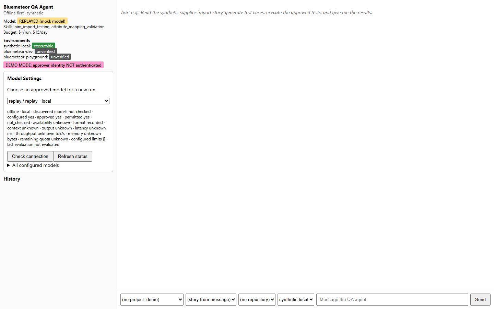

# UI-1 screenshots

Real running app captures, taken on 2026-10-15. Planning is labeled replay. Execution uses Chromium and the local synthetic SUT with seeded defects. Local authenticated screenshots use temporary test users; they are not real-model human approval evidence.

## Before

Initial workspace at [1920×1080](screenshots/before/initial-1920x1080.png), [1440×900](screenshots/before/initial-1440x900.png), [1366×768](screenshots/before/initial-1366x768.png), [1024×768](screenshots/before/initial-1024x768.png), and [390×844](screenshots/before/initial-390x844.png).

[Original plan/approval](screenshots/before/approval-1440x900.png) · [original results](screenshots/before/results-1440x900.png).

## After

Initial light workspace at [1920×1080](screenshots/after/initial-light-1920x1080.png), [1440×900](screenshots/after/initial-light-1440x900.png), [1366×768](screenshots/after/initial-light-1366x768.png), [1024×768](screenshots/after/initial-light-1024x768.png), and [390×844](screenshots/after/initial-light-390x844.png).

| State | Screenshot |
|---|---|
| Local sign-in | [Login](screenshots/after/login.png) |
| Conversation / awaiting approval | [Conversation](screenshots/after/conversation-awaiting-approval.png) |
| Test Plan tab | [Plan](screenshots/after/test-plan.png) |
| Dedicated exact-plan review | [Desktop review](screenshots/after/approval-review.png) · [mobile review](screenshots/after/approval-mobile.png) |
| Real execution in progress | [Execution](screenshots/after/execution-running.png) |
| Completed results / evidence | [Results](screenshots/after/completed-evidence.png) |
| Authorized screenshot viewer | [Evidence viewer](screenshots/after/screenshot-viewer.png) |
| Read-only model catalog / selection | [Models](screenshots/after/models.png) |
| Dark theme | [Dark workspace](screenshots/after/initial-dark-1440x900.png) |
| Narrow viewport | [Mobile](screenshots/after/initial-light-390x844.png) |
| Actual failed request | [Failed run](screenshots/after/failed-run.png) |

Screenshots are captured from real states with finite transitions settled. Error-injection recovery tests and Markdown security payloads are not used as product screenshots. Evidence is preserved in the gallery and test artifacts. See the [audit and workflow map](WORKSPACE_REDESIGN.md).
